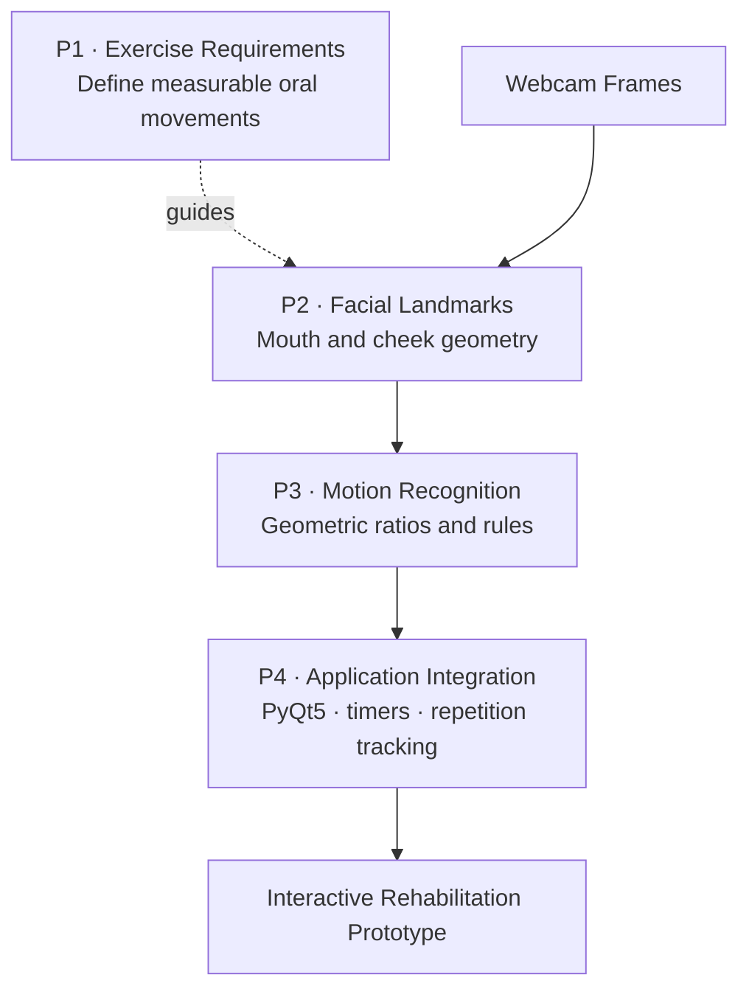

# AI-Based Oral Rehabilitation System

**Project:** Real-time computer vision for facial motion recognition and interactive oral rehabilitation.

**Focus:** Facial landmark detection · geometric feature engineering · rule-based motion recognition · real-time application integration

---

## Project at a Glance

| Workstream | Core Challenge | Engineering Approach | Outcome |
|---|---|---|---|
| **P1 — Problem Definition** | Rehabilitation movements need observable, machine-readable criteria | Translate mouth and cheek exercises into geometric measurements | Defined motion detection tasks |
| **P2 — Feature Extraction** | Raw webcam frames do not directly represent movement | Detect facial landmarks and calculate mouth and cheek distances and ratios | Extracted measurable facial features |
| **P3 — Motion Recognition** | Facial measurements must be mapped to exercise actions | Implement threshold-based rules for selected oral movements | Built mouth and cheek motion detection logic |
| **P4 — System Integration** | Recognition code needs an interactive workflow | Connect webcam processing and motion feedback to a PyQt5 interface | Developed an interactive prototype with timing and repetition tracking |

---

## End-to-End System Overview



**Storyline:** define measurable movements → extract facial geometry → recognize exercise actions → integrate the algorithms into a real-time application.

---

## Project Details

### P1 — Problem Definition

> **Key Question —** How can oral rehabilitation exercises become measurable computer vision tasks?

- Translated observable mouth and cheek movements into recognition requirements rather than relying on video display alone.
- Selected geometric measurements—such as mouth opening, horizontal mouth distance, and cheek landmark distances—as inputs for motion detection.

**Engineering takeaway:** Establish motion criteria before choosing a recognition rule.

### P2 — Facial Feature Extraction

> **Key Question —** How do we turn live camera frames into numerical features?

- Processed webcam frames and obtained facial landmarks using computer vision libraries.
- Computed mouth height, mouth width, and relative distances around facial features.
- Used geometric relationships as compact descriptors for subsequent motion recognition.

**Engineering takeaway:** Convert raw images into interpretable features before evaluating movements.

### P3 — Motion Recognition Algorithm

> **Key Question —** How can measured facial geometry indicate an exercise movement?

- Implemented rule-based checks on landmark measurements to detect selected mouth-opening and cheek movements.
- Used geometric ratios and thresholds to distinguish movement states.
- Connected recognition states to exercise counters and on-screen feedback.

**Engineering takeaway:** Build explainable motion logic on top of extracted features.

### P4 — Real-Time System Integration

> **Key Question —** How can the recognition pipeline support an interactive exercise workflow?

- Integrated webcam frame processing and detection results into a PyQt5 GUI.
- Added exercise controls, timing, repetition tracking, and visual feedback.
- Connected the recognition pipeline with the application interface to create an interactive prototype.

**Engineering takeaway:** Move from individual vision functions to an end-to-end application workflow.

---

## Key Engineering Takeaways

- **Problem formulation:** Converted exercise requirements into observable facial motion tasks.
- **Computer vision and algorithm design:** Combined facial landmark extraction with geometric features and rule-based recognition.
- **Software integration:** Connected live camera processing, motion feedback, and interactive GUI controls.

---

## Tech Stack

| Area | Technologies / Methods |
|---|---|
| **Programming** | Python |
| **Computer Vision** | OpenCV · MediaPipe · `face_recognition` · dlib |
| **Feature & Motion Logic** | Facial landmarks · geometric distances · ratios · rule-based thresholds |
| **Application** | PyQt5 · webcam processing · interactive exercise tracking |

---

## Repository Structure

```text
.
├── README.md
├── main.py
├── mouth_function.py
├── Mouth.ui
└── requirements.txt
```

**Repository scope:** A portfolio-oriented snapshot of an earlier prototype. `main.py` originates from `main_V2.py`, `mouth_function.py` contains geometric feature and motion logic, and `Mouth.ui` defines the interface. The original application also referenced local instructional videos and a logo that are not provided here. The full GUI workflow has not been revalidated in a clean environment.
